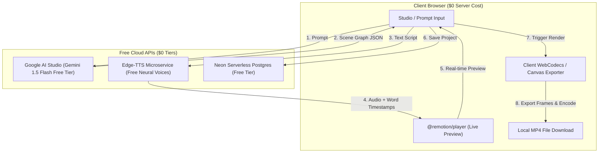
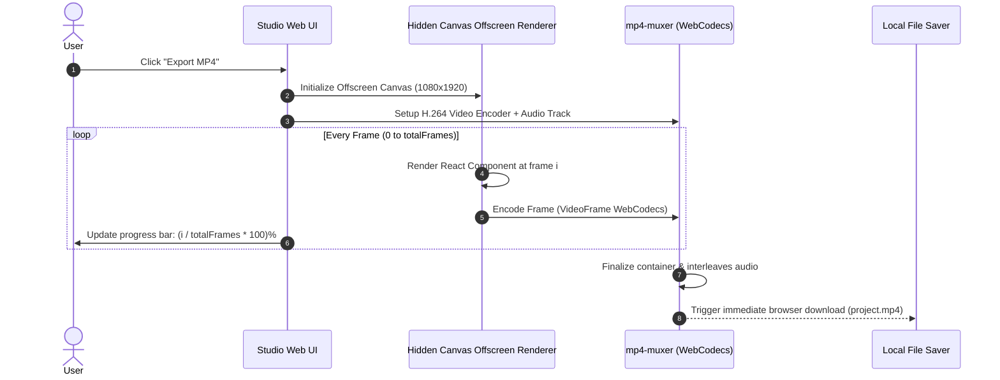
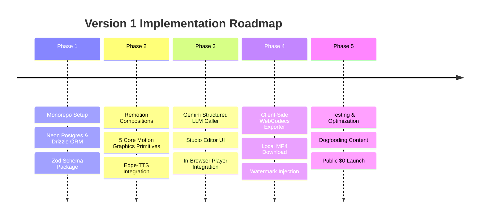

# AI Motion Graphics SaaS — Version 1 Technical Specification & Implementation Plan

> **Objective:** Build and launch an automated AI motion graphics video generator (turning prompts into short-form vertical explainer videos with voiceover, animated diagrams, word-synced captions, and counters) operating at **$0 operational cost** prior to customer revenue.

---

## 1. Zero-Cost ($0) Architecture Overview

To achieve zero infrastructure costs until paying customers subscribe, heavy server-side video rendering is eliminated in Version 1. Instead, frame rasterization and MP4 muxing are offloaded entirely to the client's web browser using modern Web APIs (**HTML5 Canvas**, **WebCodecs**, and **`mp4-muxer`**).



---

## 2. Complete Tech Stack Matrix

| Layer | Technology | Free Tier Allocation / Details |
| :--- | :--- | :--- |
| **Monorepo** | `pnpm` + `turborepo` | Open source, fast caching, workspace orchestration. |
| **Web Framework** | **Next.js 15 (App Router)** | Deployed to Vercel Hobby / Cloudflare Pages ($0). |
| **Styling & UI** | **Tailwind CSS + Shadcn/UI** | Component library, Lucide icons, Dark mode. |
| **Video Engine** | **Remotion (`@remotion/player`)** | React-based programmatic video framework. |
| **In-Browser Video Exporter** | **WebCodecs API + `mp4-muxer`** | Hardware-accelerated H.264 client-side rendering ($0 server CPU). |
| **Database** | **Neon Postgres** | Free serverless PostgreSQL (0.5 GiB storage, branching). |
| **ORM** | **Drizzle ORM** | Type-safe, lightweight, zero-overhead queries and migrations. |
| **LLM Engine** | **Google Gemini 1.5 Flash** (Google AI Studio) | 15 RPM / 1M TPM free tier with structured JSON output support. |
| **TTS & Alignment** | **`edge-tts` (Microsoft Edge Neural Voices)** | High-quality neural voices with exact word boundary timestamps. |
| **Vector Assets** | **`@iconify/react`** | On-demand vector access to 200,000+ open-source icons. |
| **Authentication** | **Clerk** or **Supabase Auth** | Free tier (up to 10,000 monthly active users). |

---

## 3. Monorepo Structure

```
ai-motion-studio/
├── apps/
│   └── web/                         # Next.js 15 Web Application
│       ├── app/
│       │   ├── (auth)/              # Sign-in / Sign-up routes
│       │   ├── dashboard/           # User dashboard & project listing
│       │   ├── editor/[id]/         # Studio workspace & Remotion player
│       │   └── api/
│       │       ├── generate/        # Gemini LLM orchestration endpoint
│       │       └── tts/             # Edge-TTS synthesis & timestamp parser
│       ├── components/
│       │   ├── editor/              # Timeline, scene drawer, prompt bar
│       │   └── player/              # Client Remotion Player wrapper
│       └── lib/
│           ├── client-render.ts     # In-browser WebCodecs MP4 export engine
│           └── gemini.ts            # Structured JSON prompt caller
│
├── packages/
│   ├── video/                       # Shared Remotion React Compositions
│   │   ├── src/
│   │   │   ├── Root.tsx             # Remotion composition registry
│   │   │   ├── compositions/        # Main Video Composition wrapper
│   │   │   ├── primitives/          # Reusable Motion Graphics Blocks
│   │   │   │   ├── FlowNode.tsx     # Tech cards, server/DB nodes, badges
│   │   │   │   ├── AnimatedPath.tsx # SVG Bezier curves with packet flow
│   │   │   │   ├── StatCounter.tsx  # Spring-interpolated numerical counters
│   │   │   │   ├── KineticText.tsx  # Word-by-word synced subtitle cards
│   │   │   │   └── Comparison.tsx   # Split-screen comparison cards
│   │   │   └── styles/              # Typography, spring physics presets
│   │   └── package.json
│   │
│   ├── schema/                      # Shared TypeScript / Zod Schemas
│   │   ├── src/
│   │   │   ├── scene.ts             # Scene Graph & Component JSON contract
│   │   │   └── project.ts           # Project metadata and render options
│   │   └── package.json
│   │
│   └── db/                          # Neon Postgres + Drizzle ORM
│       ├── src/
│       │   ├── schema.ts            # Drizzle table definitions
│       │   └── index.ts             # Drizzle client instance
│       ├── drizzle.config.ts
│       └── package.json
│
├── turbo.json
├── pnpm-workspace.yaml
└── package.json
```

---

## 4. Database Schema (Drizzle ORM + Neon Postgres)

The schema manages users, video projects, structured scene data, and export logs.

```typescript
// packages/db/src/schema.ts
import { pgTable, text, timestamp, uuid, jsonb, integer, boolean } from "drizzle-orm/pg-core";

export const users = pgTable("users", {
  id: text("id").primaryKey(), // Clerk/Supabase Auth ID
  email: text("email").notNull().unique(),
  name: text("name"),
  createdAt: timestamp("created_at").defaultNow().notNull(),
});

export const projects = pgTable("projects", {
  id: uuid("id").defaultRandom().primaryKey(),
  userId: text("user_id").references(() => users.id, { onDelete: "cascade" }).notNull(),
  title: text("title").notNull(),
  prompt: text("prompt").notNull(),
  aspectRatio: text("aspect_ratio").default("9:16").notNull(), // '9:16' or '16:9'
  theme: text("theme").default("dark-neon").notNull(),
  voiceId: text("voice_id").default("en-US-ChristopherNeural").notNull(),
  fps: integer("fps").default(30).notNull(),
  audioUrl: text("audio_url"), // Local blob or Cloudflare R2 URL
  createdAt: timestamp("created_at").defaultNow().notNull(),
  updatedAt: timestamp("updated_at").defaultNow().notNull(),
});

export const scenes = pgTable("scenes", {
  id: uuid("id").defaultRandom().primaryKey(),
  projectId: uuid("project_id").references(() => projects.id, { onDelete: "cascade" }).notNull(),
  orderIndex: integer("order_index").notNull(),
  type: text("type").notNull(), // 'workflow' | 'stat_counter' | 'comparison' | 'kinetic_quote'
  voiceoverText: text("voiceover_text").notNull(),
  durationFrames: integer("duration_frames").notNull(),
  // Complete JSON configuration for nodes, icons, arrows, values
  layoutPayload: jsonb("layout_payload").notNull(),
  // Word timestamps returned by Edge-TTS for subtitle highlighting
  wordTimestamps: jsonb("word_timestamps").notNull(),
});

export const exports = pgTable("exports", {
  id: uuid("id").defaultRandom().primaryKey(),
  projectId: uuid("project_id").references(() => projects.id, { onDelete: "cascade" }).notNull(),
  format: text("format").default("mp4").notNull(),
  durationSeconds: integer("duration_seconds").notNull(),
  renderedClientSide: boolean("rendered_client_side").default(true).notNull(),
  createdAt: timestamp("created_at").defaultNow().notNull(),
});
```

---

## 5. The Scene Graph Schema (LLM Structured Contract)

The LLM is restricted to generating this exact schema using Gemini's `response_schema` mode:

```typescript
// packages/schema/src/scene.ts
import { z } from "zod";

export const NodeItemSchema = z.object({
  id: z.string(),
  label: z.string(),
  icon: z.string().describe("Iconify key e.g. lucide:server, simple-icons:docker"),
  color: z.string().default("#3B82F6"),
});

export const EdgeItemSchema = z.object({
  from: z.string(),
  to: z.string(),
  label: z.string().optional(),
});

export const ScenePayloadSchema = z.object({
  speech: z.string().describe("The exact spoken sentence for this scene"),
  type: z.enum(["workflow", "stat_counter", "comparison", "kinetic_quote"]),
  nodes: z.array(NodeItemSchema).optional(),
  edges: z.array(EdgeItemSchema).optional(),
  statData: z.object({
    prefix: z.string().default(""),
    value: z.number(),
    suffix: z.string().default(""),
    label: z.string(),
  }).optional(),
  sfxCue: z.enum(["pop", "whoosh", "ding", "none"]).default("pop"),
});

export const FullVideoPlanSchema = z.object({
  title: z.string(),
  scenes: z.array(ScenePayloadSchema),
});

export type FullVideoPlan = z.infer<typeof FullVideoPlanSchema>;
```

---

## 6. Client-Side In-Browser Video Rendering Engine

To avoid paying for AWS EC2 or Lambda render workers on Day 1, rendering is performed in the user's browser using **HTML5 Canvas**, **WebCodecs**, and **`mp4-muxer`**:



> [!TIP]
> **Performance:** Modern laptops (M1/M2 Macs or modern Intel/AMD laptops with hardware H.264 encoders) render a 60-second 1080x1920 30fps video in the browser in **15 to 35 seconds**, completely bypassing any server billing.

---

## 7. Phased Implementation Plan



### Phase 1: Workspace & Data Foundation
* [ ] Initialize pnpm workspace with Turborepo.
* [ ] Configure Neon Postgres database project and connect Drizzle ORM in `packages/db`.
* [ ] Generate and push database migrations for `users`, `projects`, `scenes`, and `exports`.
* [ ] Build `packages/schema` exporting `FullVideoPlanSchema` and TypeScript typings.

### Phase 2: Remotion Core & Audio Engine
* [ ] Initialize `packages/video` with Remotion dependencies.
* [ ] Build the 5 core motion primitives:
  * `<FlowNode />`: Icon + label + border glow.
  * `<AnimatedPath />`: SVG Bezier curve with traveling packet dot.
  * `<StatCounter />`: Spring-interpolated numerical counter.
  * `<KineticText />`: Word-synced highlighted subtitle block.
  * `<Comparison />`: Two-column comparison layout.
* [ ] Implement `edge-tts` API route in `apps/web/app/api/tts/route.ts` to return audio buffer and word boundary offsets.

### Phase 3: Gemini LLM & Studio Workspace
* [ ] Create `apps/web/app/api/generate/route.ts` calling Google Gemini 1.5 Flash with `response_schema` bound to `FullVideoPlanSchema`.
* [ ] Build Studio Editor (`apps/web/app/editor/[id]`):
  * Left pane: Prompt input, voice selector, and scene cards.
  * Right pane: Embedded `@remotion/player` displaying real-time preview.

### Phase 4: In-Browser MP4 Export Engine
* [ ] Implement `client-render.ts` utilizing `mp4-muxer` and the WebCodecs `VideoEncoder`.
* [ ] Render each frame to an offscreen canvas and feed into the encoder.
* [ ] Add free-tier watermark overlay (`⚡ Made with [AppName].com`) at bottom-right corner.
* [ ] Output final `.mp4` blob and trigger browser download.

### Phase 5: Verification & Launch
* [ ] Verify end-to-end flow: Enter prompt $\rightarrow$ Gemini generates scenes $\rightarrow$ Edge-TTS synthesizes voice $\rightarrow$ Web player previews $\rightarrow$ Client exports clean 1080x1920 MP4.
* [ ] Test across Chrome, Edge, and Safari for WebCodecs compatibility.
* [ ] Deploy `apps/web` to Vercel Hobby ($0).
